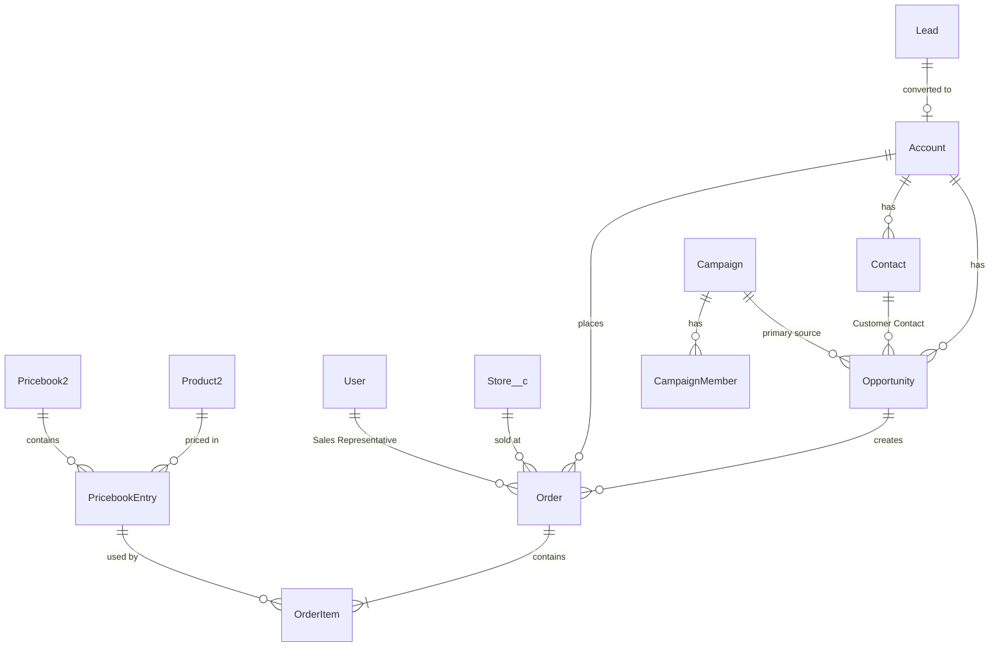

# Blush – Retail & Wholesale Management (Phase 1)

Solution design, assumptions and test evidence for the Salesforce mini project.

## 1. Approach

Standard Salesforce objects carry the business process (Lead → Account/Contact → Opportunity → Order). Declarative tools are used wherever they meet the requirement: record types, validation rules, formula fields, an approval process, list views, reports and dashboards. Apex is used only where declarative tools fall short:

| Need | Why Apex |
|---|---|
| Find or convert a lead, or create the customer, from opportunity details | Lead conversion and duplicate matching across Contact and Lead in one bulk-safe step |
| Auto-create price book entries when a product gets a sales channel | Two price books, a 30% wholesale formula and activate/deactivate logic on a multi-select picklist |
| Tax per order line (category slab, CGST/SGST vs IGST) and order totals | Needs the product category, a per-unit threshold and the order's billing state; totals feed the approval process |
| Nightly follow-up reminders | Scheduled batch over open opportunities and their tasks/events |
| Invoice PDF | Visualforce `renderAs="pdf"`, plus an LWC quick action that saves it to the order's Files |

Every trigger is a one-line dispatcher to a service class, bulk-safe (no SOQL/DML in loops) and tested with 200-record batches.

## 2. Data model

### Objects and record types

| Object | Record types | Key custom fields |
|---|---|---|
| Lead | – | Customer Type (Retail/Wholesale) |
| Account | Retail (B2C), Wholesale (B2B) | Sales Channel (formula) |
| Contact | – | – |
| Opportunity | Retail, Wholesale (Blush Sales Process) | Customer Name, Customer Email, Customer Phone, Company Name, Customer Contact, Sales Channel |
| Order | Retail, Wholesale | Store, Sales Representative, Payment Mode, Payment Status, Discount Approval Status, Tax Type, Total Discount, Effective Order Amount, Total CGST/SGST/IGST/GST, Total Amount Payable, Commission (formula), Invoice Number (formula) |
| Order Product | – | Discount (per unit), Discount %, Taxable Amount, GST Rate, CGST, SGST, IGST, Total Tax, Net Price, Assumed Revenue/Cost/Profit |
| Product | – | Category (Garments/Jewellery), Sales Channel (multi-select), Base Price, Wholesale Price (formula) |
| Store (custom) | – | Address, City, State, GSTIN, Phone, Website, Default Store |
| GST Rate (custom metadata) | – | Category, Threshold Amount, Rate Up To / Above Threshold |
| Task / Event | – | Follow-up Reminder, Completed (for events) |

Price books: **Standard**, **Blush Retail Price Book** (base price) and **Blush Wholesale Price Book** (base − 30%).

## 3. Requirement mapping

| # | Requirement | Implementation |
|---|---|---|
| A.1–3, A.6 | Prospects/customers, retail vs wholesale | Lead, Account, Contact, Opportunity, Order; Retail/Wholesale record types on Account, Opportunity and Order |
| A.4 | Capture name, email, phone on opportunity | Customer Name / Email / Phone fields in the "Customer Details" layout section |
| A.5 | Match lead or create customer | `OpportunityCustomerService` (before insert/update): existing Contact → reuse its Account; open Lead → convert (no extra opportunity); else create Account + Contact. Account record type follows the opportunity. The contact becomes the primary Opportunity Contact Role |
| B.7–8 | Campaigns; current month view | Standard Campaign object; "Campaigns This Month" list view and report (start before next month and end on/after the 1st) |
| C.9–12 | Catalogue, two price books, 30% lower wholesale, no admin setup | `Product2Trigger` → `ProductPricebookService` creates/updates/deactivates price book entries when Sales Channel, Base Price or Active changes |
| C.13 | Channel uses matching account and price book | Opportunity and Order triggers set the channel price book and reject a mismatched account or price book |
| D.14–17 | Nightly reminders | `OpportunityFollowUpBatch` (Batchable + Schedulable, 1 AM): open opportunity + incomplete task or not-completed event dated run date −5 … run date → one High-priority task for the owner, never more than one per opportunity |
| E.18–20 | Commission | Order.Commission = 1% of Effective Order Amount when ≤ Rs. 1,000, else Rs. 30 (formula); Effective Order Amount = net received − taxes |
| F.21–22 | Lock paid orders | Validation rules on Order and Order Product, plus a delete guard in Apex; the **Edit Paid Orders** custom permission (Blush Manager) bypasses them |
| G.23–24 | Invoice PDF | `BlushInvoice` Visualforce page; **Generate Invoice** quick action (LWC) to preview or save the PDF to Files |
| G.25 | Discount > 10% needs approval | Order Product discount % rolled up to Order.Max Line Discount %; "Order Discount Approval" process, auto-submitted by Apex; orders cannot be activated or paid until approved |
| G.26–29 | GST | GST_Rate__mdt: Garments 5% / 12% above Rs. 1,000, Jewellery 3%. Maharashtra billing → CGST + SGST (half each), otherwise IGST. Net = (Unit − Discount) × Qty + Tax |
| H | Reports and dashboards | 17 reports in **Blush Reports**; Retail, Wholesale and Marketing dashboards in **Blush Dashboards** |
| I.30–32 | Users, licenses, app | Permission sets Blush Sales User, Blush Marketing User and Blush Manager; "Blush" Lightning app set as default for the System Administrator, Standard User and Marketing User profiles |
| J.33–34 | Testing | 83 Apex tests, 100% coverage of every Blush class and trigger (see `Test-Evidence.md`) |

### Reports

| Requirement | Report |
|---|---|
| Monthly commission by sales rep | Monthly Commission by Sales Rep (reps sorted by commission within each month) |
| Quarterly revenue statement | Quarterly Revenue Statement (assumed cost Rs. 100, retail Rs. 200, wholesale Rs. 140 per unit) |
| Monthly order report | Monthly Order Report |
| Retail vs wholesale with previous month | Retail vs Wholesale Monthly Amount (matrix with a `PREVGROUPVAL` "Previous Month Amount" column) |
| Top 3 reps by commission per month | Monthly Commission by Sales Rep, plus Top Reps by Commission – This Month (dashboard shows the top 3) |
| Total GST payable | Total GST Payable |
| Top 10 products by net sales quantity | Top 10 Products by Net Sales Quantity (dashboard shows the top 10) |
| Team dashboards | Retail and Wholesale variants (monthly sales, commission by rep, top products); Campaigns This Month, Campaign Performance, Leads by Source |

## 4. Security and licences

| Group | Licence / profile | Permission set | Access |
|---|---|---|---|
| Sales users | Salesforce / Standard User | Blush Sales User | Create/edit Leads, Accounts, Contacts, Opportunities, Orders; read Products, Price Books, Campaigns, Stores; generate invoices. Tax and total fields are read-only |
| Marketing users | Salesforce / Marketing User, **Marketing User** checkbox on | Blush Marketing User | Full Campaign access, Leads create/edit, read-only sales data |
| Managers / admins | Salesforce / System Administrator | Blush Manager | Maintain products and stores, approve discounts, edit paid orders |

Campaign management needs a full Salesforce licence with the Marketing User feature, so the Salesforce Platform licence is not suitable for either group.

## 5. Assumptions

1. **Sales Representative** = owner of the opportunity the order came from (otherwise the order owner). It is stored on Order.Sales_Representative__c and drives commission reports.
2. **Duplicate matching**: email beats phone; the newest record wins. An existing Contact takes precedence over a Lead, so a returning customer is never duplicated. Emails are compared case-insensitively and phones on their last 10 digits.
3. If email and phone match **different leads**, the email match is converted and the other lead is left untouched for manual review.
4. A lead owned by a **queue** is converted with the processing user as owner.
5. **Garment GST slab** uses the per-unit taxable value (unit price − discount), as Indian GST does for apparel. The sample sheet shows the Gown at 5% on Rs. 1,400; that conflicts with requirement 27, so the requirement wins.
6. **Net Price** follows requirement 29 (tax added on top). The sample sheet treats net price as tax-inclusive, so its effective amounts differ slightly.
7. **Discount** is entered per unit as an amount (like the sample sheet). The threshold is 10% of unit price per line; exactly 10% needs no approval.
8. A **blank billing state** is treated as a counter sale in Maharashtra (CGST + SGST).
9. **Commission and revenue** reports count only orders with Payment Status = Paid ("net amount received").
10. **Invoice number** = "INV-" + order number. Invoice date = order start date.
11. **Events** have no status, so a "Completed" checkbox was added; unticked events in the window count as incomplete.
12. The **reminder limit** is one per opportunity, ever (the literal reading of requirement 16).
13. **Sample products**: the trainer data listed Jeans and Gown only, so 10 more products were added (`data/Blush_Products.csv`) to demonstrate both categories and channels.

## 6. Limitations / to clarify with the mentor

- The approval step is assigned to a named user (the org admin). In a real org this should be a manager hierarchy or queue.
- The Developer Edition has only one free Salesforce licence. The demo Sales user (Sneha Patil) was created; the Marketing user script is ready but needs a free licence.
- Person Accounts were not enabled (it is irreversible). Retail customers use business accounts named after the person.
- Phone matching in SOQL needs an exact stored value. Common Indian formats are searched (raw, 10 digits, +91, 0-prefix), but other formats may be missed.
- Activated orders cannot have lines edited (a platform rule), so changing the billing state of an activated order fails until it is moved back to Draft.
- Top 3 / top 10 per period are shown by sorting plus dashboard limits; Lightning summary reports cannot limit rows per group.
- eBay integration and website ordering are Phase 2/3 and out of scope.

## 7. Demo walkthrough

1. **Products**: open *Jeans* and add *Wholesale* to Sales Channel. A Wholesale price of Rs. 350 appears in the wholesale price book with no admin step.
2. **New retail customer**: create a Retail opportunity with a new name, email and phone. A Retail account, contact and primary contact role are created, and the retail price book is set.
3. **Lead conversion**: create an opportunity with the email of lead *Meera Nair*. The lead is converted and no duplicate opportunity is created.
4. **Order and tax**: create an order from the opportunity and add products. The Maharashtra address shows CGST + SGST; change the billing state to Karnataka and the lines switch to IGST.
5. **Approval**: give a line a discount above 10%. The order goes to *Pending* approval and cannot be paid until approved.
6. **Paid lock**: mark an order Paid (Payment Mode required). Sneha (sales user) can no longer edit it.
7. **Invoice**: use *Generate Invoice* → *Preview PDF* / *Save PDF to Order* (sample: `Sample-Invoice-INV-00000100.pdf`).
8. **Reminders**: the scheduled job created a reminder for Kavya Iyer's opportunity (task 3 days old) but not Joshi Boutique's (12 days old).
9. **Analytics**: open *Blush Retail / Wholesale / Marketing Dashboard*.
